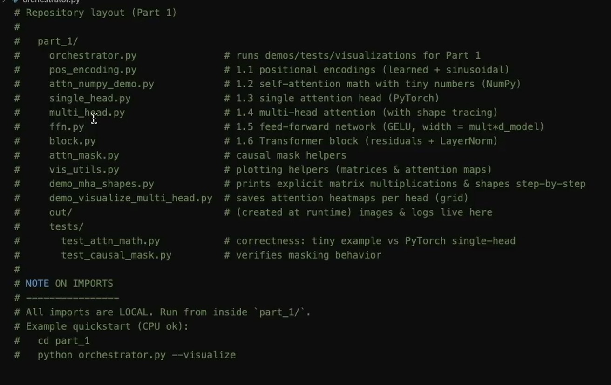
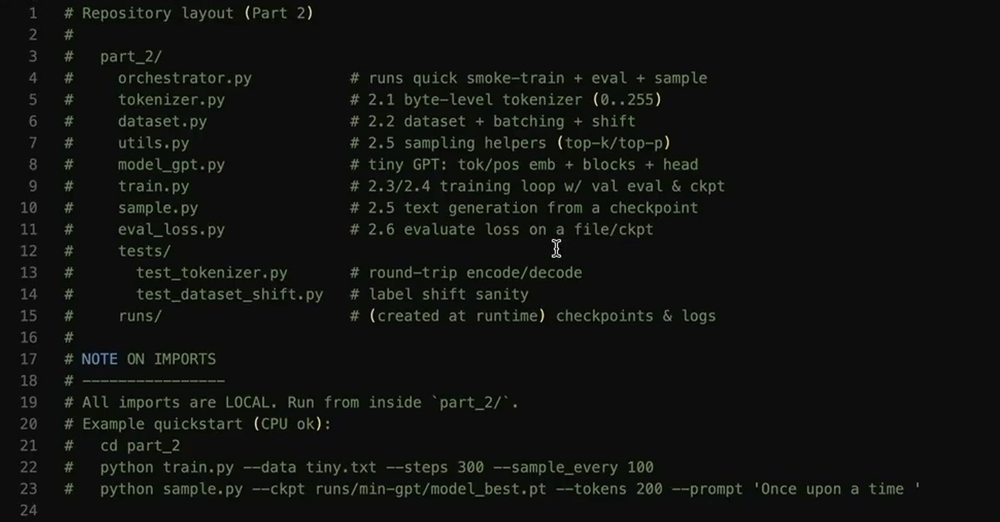

# LLM from Scratch 🚀

A modular, clean, and educational implementation of modern Large Language Model (LLM) components and training pipelines built from scratch in PyTorch.

---

## 📐 Architecture Overview





---

## 📁 Repository Layout

```text
LLM_from_Scratch/
├── 1_Transformer_arch/            # Part 1: Core Attention & Transformer Architecture
│   ├── single_head.py             # Single-Head Self-Attention module
│   ├── multi_head.py              # Multi-Head Self-Attention (MHSA) module
│   ├── attn_mask.py               # Causal attention masking helpers
│   ├── pos_encoding.py            # Sinusoidal Positional Encoding
│   ├── attn_numpy_demo.py         # Numpy baseline demonstration
│   ├── demo_mha_shapes.py         # Tensor shape walkthroughs for MHSA
│   ├── demo_visualize_multi_head.py# Attention heatmaps & visualizer
│   ├── test_attn_math.py          # Pytest mathematical sanity checks
│   ├── test_causal_mask.py        # Pytest causal masking tests
│   ├── vis_utils.py               # Visualization helper utilities
│   └── orchestrator.py            # Master test runner & visualization suite
│
├── 2_Training_Tiny_LLM/           # Part 2: Training & Generation Pipeline
│   └── orchestrator.py            # Runs quick smoke-train, eval & sampling
│
├── Architecture/                  # System architecture diagrams & reference visuals
│   ├── Part_1_Building_Transformer_Arch.jpg
│   └── Part_2_Training_LLM.jpg
│
├── .gitignore                     # Git ignore rules for Python, PyTorch & OS artifacts
└── requirements.txt               # Required Python dependencies
```

---

## ⚡ Quickstart & Setup

### 1. Prerequisites & Installation

Clone the repository and install the dependencies:

```bash
git clone <your-repo-url>
cd LLM_from_Scratch

# Create and activate a virtual environment (optional but recommended)
python3 -m venv .venv
source .venv/bin/activate

# Install required dependencies
pip install -r requirements.txt
```

---

## 🧪 Running Tests & Visualizations

To run the complete test suite, shape walkthroughs, and visualization visual generators for **Part 1 (Transformer Architecture)**:

```bash
cd 1_Transformer_arch
python orchestrator.py --visualize
```

This will:
- Execute `numpy` baseline attention calculations.
- Run unit test assertions via `pytest`.
- Print step-by-step tensor shape transformations for Multi-Head Attention.
- Generate attention heatmaps and save PNG diagrams to `./out/`.

---

## 📋 Requirements

- `torch >= 2.0.0`
- `numpy >= 1.24.0`
- `matplotlib >= 3.7.0`
- `pytest >= 7.0.0`

---

## 📝 License

This project is open-source and available under the [MIT License](LICENSE).
